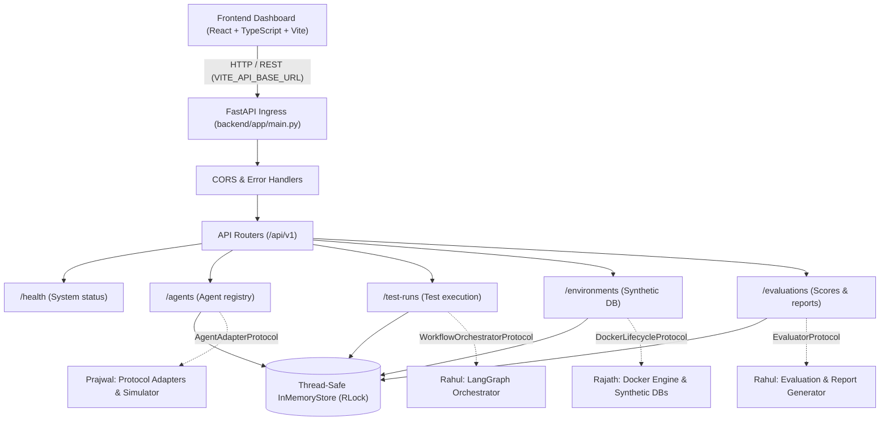

# NEXORA Architecture & Integration Guide

## Platform Overview

NEXORA is designed as a modular monolith with clear domain boundaries, providing an AI testing and benchmarking foundation. The architecture isolates API ingress, workflow orchestration, synthetic database provisioning, and evaluation reporting into distinct components that can evolve into distributed microservices in later phases.

---

## High-Level System Architecture

---

## Frontend-to-Backend Flow

1. **Client Ingress**: The React frontend (`apps/web/`) interacts with the backend via the typed API client (`apps/web/src/api.ts`). The base URL is dynamically sourced from `import.meta.env.VITE_API_BASE_URL`, defaulting to `http://localhost:8000/api/v1`.
2. **CORS & Middleware**: Requests pass through FastAPI's `CORSMiddleware`, configured with allowed origins (e.g. `http://localhost:5173`, `http://localhost:3000`).
3. **Route Handling & Schema Validation**: Ingress payloads are validated using Pydantic schemas (`app/schemas/`). Invalid payloads trigger standard HTTP 422 JSON envelopes.
4. **Data Isolation & Concurrency**: All state operations are managed through the central `InMemoryStore` (`app/core/store.py`), protected by `threading.RLock` to guarantee thread safety.
5. **Response Envelope**: Every response is encapsulated within a standardized JSON envelope (`ApiEnvelope` or `ErrorEnvelope`) ensuring uniform client parsing.

---

## Module Responsibilities

### Naaneshwar — FastAPI Core, Contracts, and Integration Coordination
- **Application Core**: FastAPI bootstrap, lifespan management, route registry, error handlers, and Swagger/OpenAPI docs.
- **Shared Contracts**: Canonical request/response schemas (`app/schemas/common.py`, `agent.py`, `test_run.py`, `environment.py`, `evaluation.py`).
- **Store Abstraction**: Centralized thread-safe `InMemoryStore` with concurrency locks and reset fixtures.
- **Security & Redaction**: Automated sanitization of secrets, tokens, and passwords in agent configuration payloads.
- **Integration Protocols**: Standardized protocol contracts (`app/services/interfaces.py`) defining integration touchpoints for teammates.

### Rajath — Environment Provisioning & Storage
- **Lifecycle Integration**: Implements `DockerLifecycleProtocol`.
- **Synthetic Databases**: Automated spinning up and tear-down of PostgreSQL, MySQL, MongoDB, Redis, and Neo4j test containers.
- **Resource Management**: Safe container labeling, port allocation, and idempotent deprovisioning.

### Prajwal — Target-Agent Adapters & Simulation
- **Agent Invocation**: Implements `AgentAdapterProtocol`.
- **Protocol Adapters**: Translates standard platform test payloads to target agent protocols (OpenAI, Anthropic, REST, LangChain).
- **Synthetic Simulator**: Emulates API responses and tools for controlled agent benchmarking.

### Rahul — Workflows, Evaluation, and Reports
- **Workflow Orchestration**: Implements `WorkflowOrchestratorProtocol` using LangGraph state machines.
- **Simulated Users**: Multi-turn scenario execution against target agents.
- **Evaluation & Benchmarking**: Implements `EvaluatorProtocol` calculating scores (0-100), latency, coverage, and generating structured reports.

---

## Integration Interfaces (`backend/app/services/interfaces.py`)

The platform defines clean Python `Protocol` contracts enabling isolated local development with deterministic mocks:

| Protocol | Owner | Purpose | Mock Available |
| --- | --- | --- | --- |
| `DockerLifecycleProtocol` | Rajath | Container provisioning & synthetic DB lifecycle | `MockDockerLifecycle` |
| `AgentAdapterProtocol` | Prajwal | Invocation and reachability checks for target AI agents | `MockAgentAdapter` |
| `WorkflowOrchestratorProtocol` | Rahul | LangGraph execution graph triggering and cancellation | `MockWorkflowOrchestrator` |
| `EvaluatorProtocol` | Rahul | Benchmark evaluation, score calculation, report synthesis | `MockEvaluator` |

---

## Implementation Status (Current vs. Planned)

| Component | Status | Notes |
| --- | --- | --- |
| FastAPI Application & Lifespan | **Operational** | Configured with CORS, root health, `/docs`, and versioned routes |
| Shared Response Envelopes | **Operational** | Standardized `{ success, data, error }` across all endpoints |
| Domain Error Handling | **Operational** | Handlers for 400, 404, 409, 422, and safe production 500s |
| In-Memory Data Store | **Operational** | Concurrency-protected via `RLock`; test-isolated with `reset()` |
| Agent Registration & Listing | **Operational** | Auto-generates IDs, prevents duplicates, redacts sensitive keys |
| Test Run API & State Transitions | **Operational** | Validates target agents, prevents invalid cancellations |
| Execution Events & Traces | **Operational** | Run-scoped trace retrieval with sequence tracking |
| Environment Lifecycle API | **Operational** | Tracks `provisioning` and `stopped` states; no fake container URLs |
| Evaluation & Reporting API | **Operational** | Enforces valid run references; retrieves reports by ID or run ID |
| Frontend API Client | **Operational** | Typed TypeScript client in `apps/web/src/api.ts` |
| Docker Daemon Engine | *Planned* | Awaiting Rajath's Docker implementation |
| Live LLM Adapters | *Planned* | Awaiting Prajwal's protocol adapter module |
| LangGraph Workflow Engine | *Planned* | Awaiting Rahul's workflow graph implementation |
| Persistent DB Storage | *Future Phase* | SQLite / PostgreSQL adapter replacing `InMemoryStore` |

